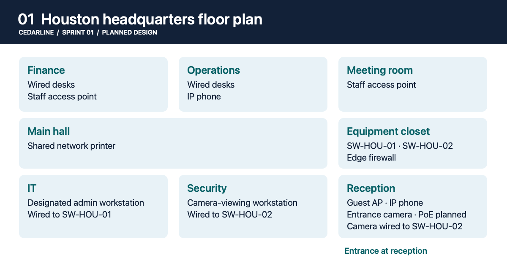
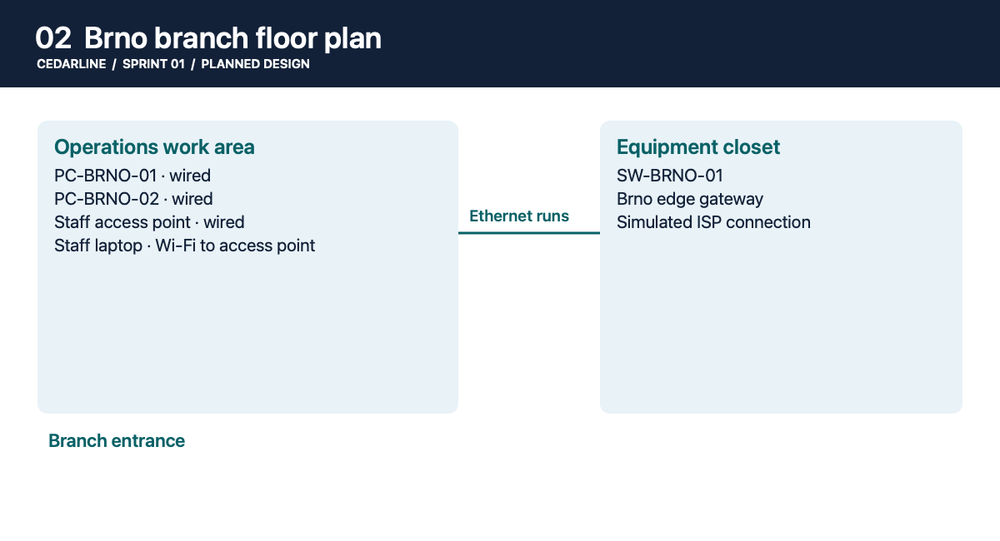
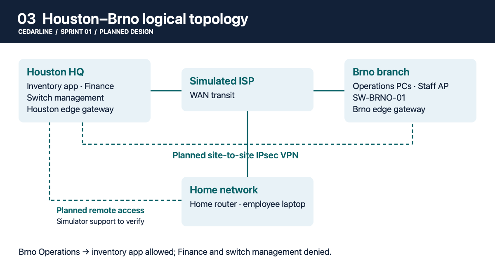

# Sprint 01 · Charter and Office Design

Cedarline’s Houston headquarters and Brno branch need separate local networks and a controlled connection between sites. The [project charter](charter.md) explains what the network must support before the branch opens.

See the [IP and VLAN plan](ip-vlan-plan.md) for the planned subnets and gateways.
See the [switch-port map](switch-port-map.md) for planned cable connections and port assignments.
See the [access matrix](access-matrix.md) for expected connections and verification status.

## 01. Houston headquarters floor plan

Houston houses Finance, Operations, IT, and Security. The plan shows where staff and guest access points, IP phones, the shared printer, and the entrance camera will go. Camera power over Ethernet is planned.

## 02. Brno branch floor plan

The Brno Operations work area has wired desks and staff Wi-Fi connected to a local switch and edge gateway.

## 03. Houston–Brno logical topology

The planned site-to-site tunnel will let Brno Operations reach the Houston inventory app. Work-from-home VPN implementation depends on simulator support. Both paths are design proposals at this stage.

## Screenshot index

| Figure | File | Status |
| --- | --- | --- |
| 01 | [Houston floor plan](screenshots/01-houston-floor-plan.png) | Design sketch |
| 02 | [Brno floor plan](screenshots/02-brno-floor-plan.png) | Design sketch |
| 03 | [Two-site topology](screenshots/03-two-site-topology.png) | Design sketch |
