# Sprint 02 · Wired Network and Core Services

This sprint built and tested the local wired networks at Houston and Brno in Cisco Packet Tracer. Houston uses two Cisco 2960-24TT switches and a Cisco 2911 router. Brno uses one 2960-24TT and one 2911. Open [cedarline-network.pkt](cedarline-network.pkt) to reproduce the checks.

## 01. Review the Houston wired topology

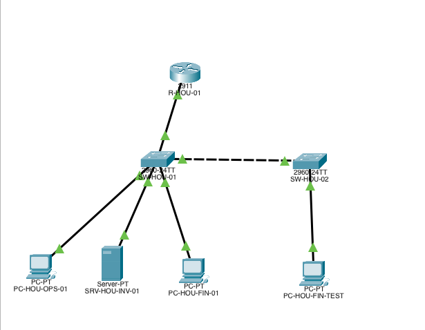

The retest topology includes the Houston router, both switches, the inventory server, and three PCs. The PCs connect to their switches with copper straight-through cables. A copper crossover cable connects `Gi0/1` on both switches. The green indicators show that the links are up.

## 04. Test Finance connectivity across the switches

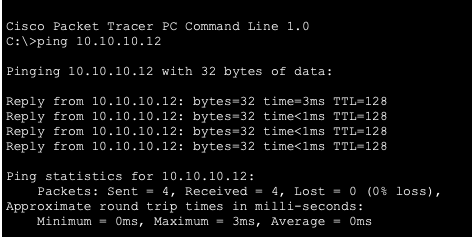

The two Finance PCs communicated across the switch uplink with zero packet loss. On both switches, `show interfaces trunk` separately confirmed that the uplink was trunking with 802.1Q and forwarding VLAN `10`.

## 07. Reach the Houston Finance gateway

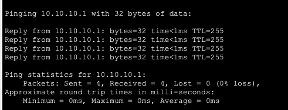

The Finance test PC reached `10.10.10.1` (`R-HOU-01 Gi0/0.10`, Finance gateway) from the far switch. The router uses a subinterface for each VLAN on its trunk to `SW-HOU-01`.

## 08. Verify routing from Finance to Operations

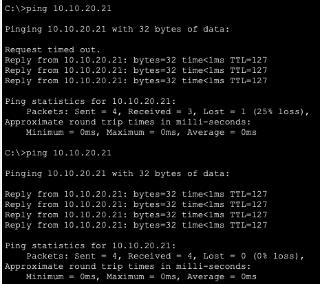

The first test timed out because the Operations PC had an incorrect default gateway. Setting it to `10.10.20.1` (`R-HOU-01 Gi0/0.20`, Operations gateway) restored the return path. The same ping to `10.10.20.11` (`PC-HOU-OPS-01`, its static address at the time) then passed. The retest shown here uses `10.10.20.21` (`PC-HOU-OPS-01`, DHCP address) and finishes with four replies and zero loss. This is the routing baseline before department isolation.

## 12. Verify reachability to the inventory server

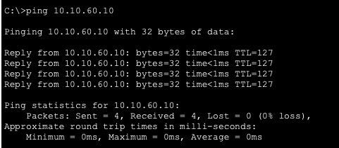

The Operations gateway initially returned `Destination host unreachable`. The router’s VLAN `60` subinterface had no IP address. After assigning `10.10.60.1` (`R-HOU-01 Gi0/0.60`, Shared Services gateway), the retest to `10.10.60.10` (`SRV-HOU-INV-01`, inventory server) returned four replies with zero loss.

## 14. Open the inventory page by name

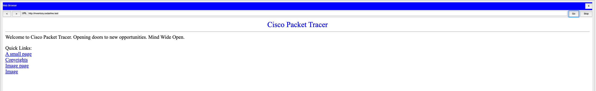

The Operations PC received `10.10.60.10` (`SRV-HOU-INV-01`, internal DNS server) through DHCP. The browser opened `http://inventory.cedarline.test` and displayed the server’s default HTTP page. That verifies name resolution and HTTP reachability for the simulated service.

## 15. Troubleshoot the Brno gateway ping

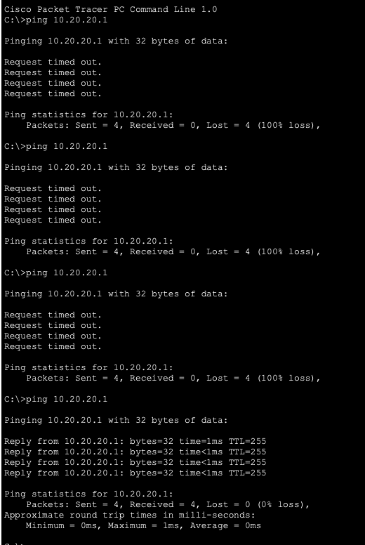

`PC-BRNO-01` had no IPv4 address. After assigning `10.20.20.11` (`PC-BRNO-01`, first Operations PC), the same ping to `10.20.20.1` (`R-BRNO-01 Gi0/0`, Brno gateway) succeeded. Brno uses an access link to its router because the wired baseline carries one VLAN.

## 16. Verify Brno PC-to-PC connectivity with static IPs

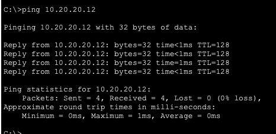

After setting `10.20.20.12` (`PC-BRNO-02`, its static address at the time), the first PC reached it with zero packet loss.

## 17. Obtain a Brno DHCP lease

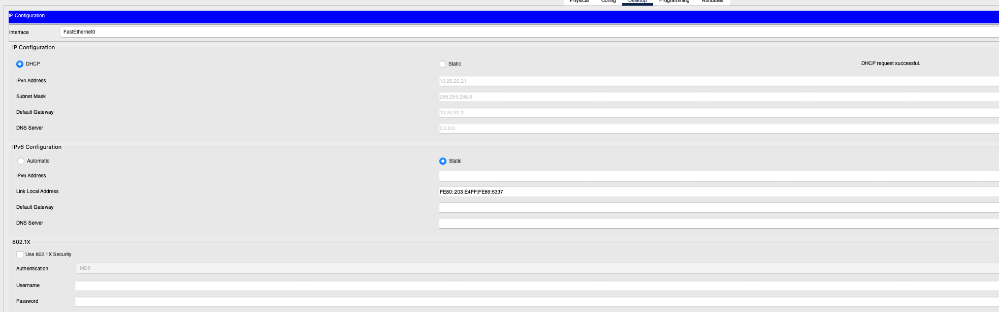

`PC-BRNO-02` received `10.20.20.21` (`PC-BRNO-02`, DHCP address), a `/24` mask, and `10.20.20.1` (`R-BRNO-01 Gi0/0`, Brno gateway).

## 18. Verify the lease on the router

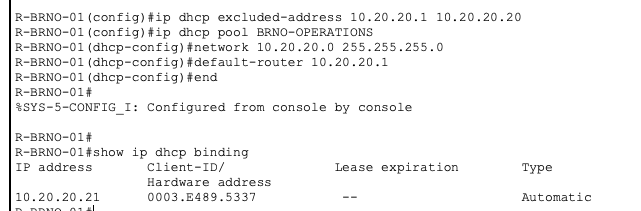

The router’s `show ip dhcp binding` output lists the same address the client received as an automatic lease.

## 19. Retest using the leased address

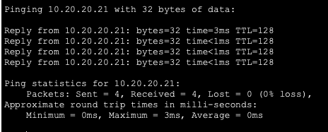

`PC-BRNO-01` reached `10.20.20.21` (`PC-BRNO-02`, DHCP address) with four replies and zero loss.

## Screenshot index

| Figure | Evidence |
| --- | --- |
| 01 | [Houston wired topology](screenshots/01-houston-wired-topology.png) |
| 04 | [Finance connectivity](screenshots/04-finance-ping.png) |
| 07 | [Finance gateway retest](screenshots/07-finance-gateway-ping.png) |
| 08 | [Finance-to-Operations routing](screenshots/08-finance-to-operations-ping.png) |
| 12 | [Operations-to-server connectivity](screenshots/12-operations-to-inventory-ping.png) |
| 14 | [Inventory page by hostname](screenshots/14-inventory-app-by-name.png) |
| 15 | [Brno gateway troubleshooting](screenshots/15-brno-gateway-troubleshooting.png) |
| 16 | [Brno static PC-to-PC test](screenshots/16-brno-pc-to-pc-ping.png) |
| 17 | [Brno DHCP client settings](screenshots/17-brno-dhcp-client.png) |
| 18 | [Brno router DHCP binding](screenshots/18-brno-dhcp-binding.png) |
| 19 | [Brno PC-to-PC retest after DHCP](screenshots/19-brno-dhcp-ping.png) |

## Handoff

Houston and Brno have working local wired baselines for the devices tested. Wi-Fi, department isolation, and the Houston–Brno VPN are scheduled for later sprints.