# Sprint 03 · Staff and Guest Wi-Fi

Wireless clients were added to Houston Finance, Houston Guest, and Brno Operations. The meeting-room AP extends Finance access. Open [cedarline-wireless.pkt](cedarline-wireless.pkt) in Packet Tracer to inspect the saved project.

## Device and port plan

| AP | Switch port | VLAN | SSID | Configured channel |
| --- | --- | --- | --- | --- |
| AP-HOU-FIN-01 | SW-HOU-01 Fa0/7 | 10 | CEDARLINE-FINANCE | 1 |
| AP-HOU-GUEST-01 | SW-HOU-02 Fa0/2 | 50 | CEDARLINE-GUEST | 6 planned, final setting unverified |
| AP-BRNO-OPS-01 | SW-BRNO-01 Fa0/3 | 20 | CEDARLINE-BRNO-OPS | 1 planned |
| AP-HOU-MEETING-01 | SW-HOU-01 Fa0/8 | 10 | CEDARLINE-FINANCE | 11 |

Each AccessPoint-PT uses Port 0 with a copper straight-through cable to the listed access port. Laptop-PT clients use WPC300N adapters. Smartphone-PT has built-in Wi-Fi.

## 01. Configure Finance Wi-Fi

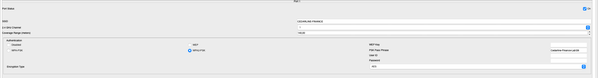

Finance AP uses CEDARLINE-FINANCE, WPA2-PSK with AES, and channel 1. The displayed passphrase is a public lab value.

## 02. Associate the Finance laptop

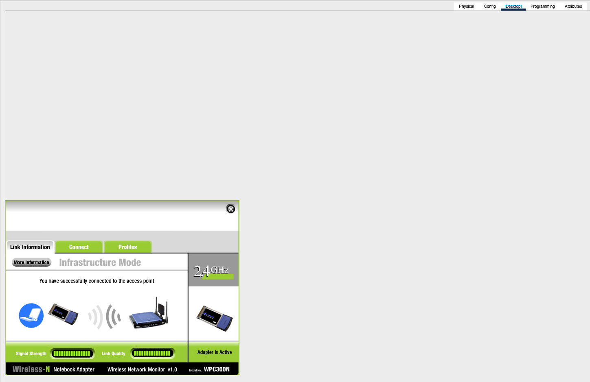

After installing the WPC300N adapter, the laptop reports a successful wireless association.

## 03. Obtain Finance DHCP settings

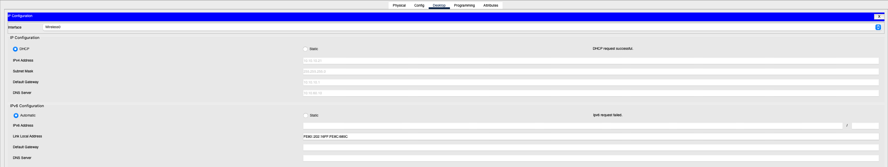

The laptop receives 10.10.10.21 (LAP-HOU-FIN-01), gateway 10.10.10.1 (R-HOU-01 Finance interface), and DNS 10.10.60.10 (inventory server).

## 04. Test Finance wireless reachability

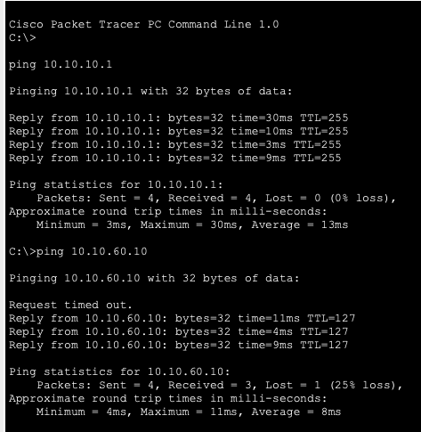

The gateway responds with zero loss. The initial inventory-server ping has one timeout and three replies.

## 05. Retest inventory reachability

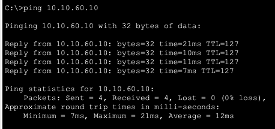

The repeat ping to 10.10.60.10 (SRV-HOU-INV-01) returns four replies with zero loss.

## 06. Open the inventory page by hostname

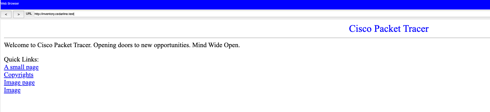

The Finance laptop resolves inventory.cedarline.test and loads the default HTTP page.

## 07. Associate the guest laptop

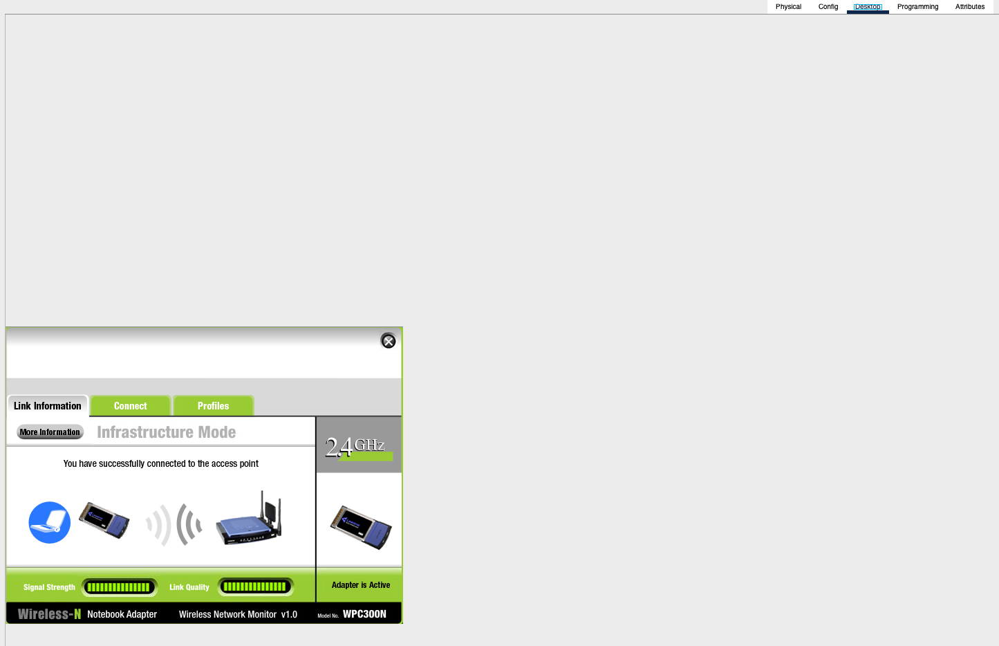

The wireless utility reports successful association.

## 08. Obtain guest DHCP settings

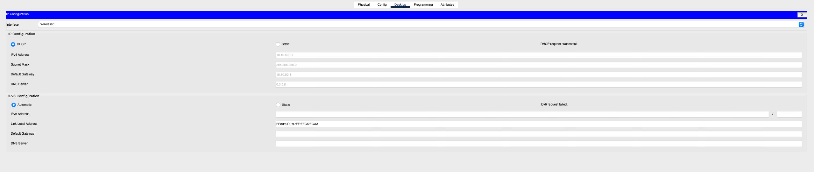

The guest laptop receives 10.10.50.21 (LAP-HOU-GUEST-01) and gateway 10.10.50.1 (R-HOU-01 guest interface).

## 09. Record the guest baseline

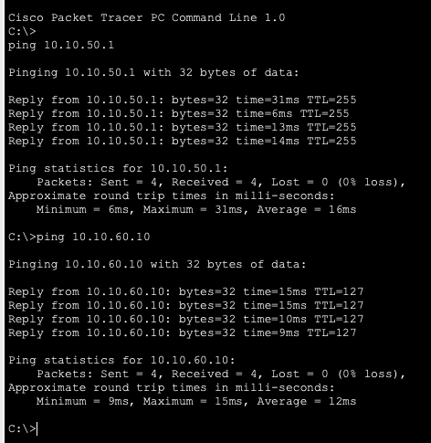

The guest laptop reaches both its gateway and the internal inventory server. Guest restrictions are scheduled for Sprint 5.

## 10. Connect the Brno smartphone

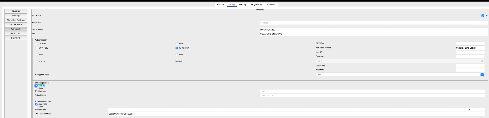

PHONE-BRNO-OPS-01 joins CEDARLINE-BRNO-OPS using WPA2-PSK/AES and receives 10.20.20.22.

## 11. Test wired-to-wireless access

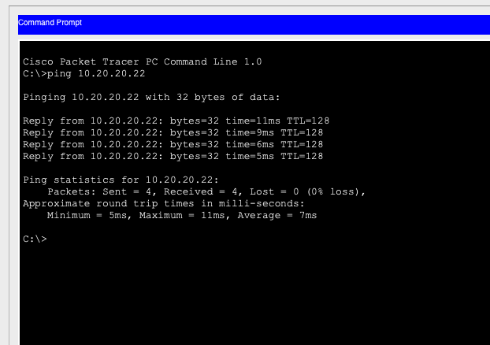

PC-BRNO-01 reaches 10.20.20.22 (Brno smartphone) with zero loss.

## 12. Investigate cross-city SSID visibility

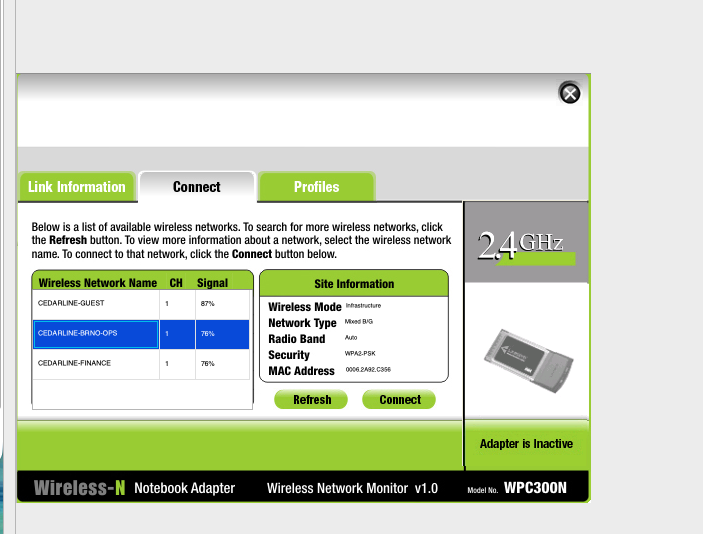

The Brno laptop can initially see Houston SSIDs because both sites share the default physical location. Logical canvas spacing did not establish geographic separation.

## 13. Create separate physical cities

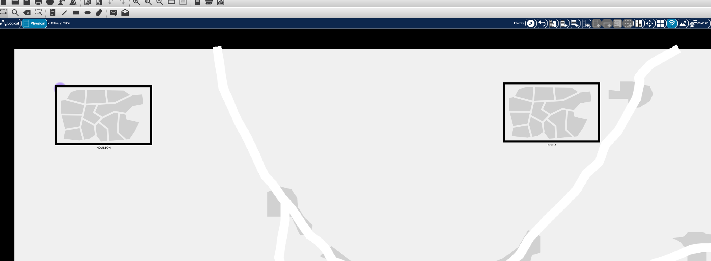

Houston and Brno are placed in separate cities in the Physical workspace.

## 14. Move Brno equipment

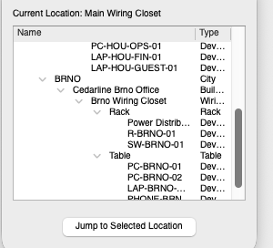

The location tree shows Brno equipment moved to its own office and wiring closet.

## 15. Verify the wireless scan after separation

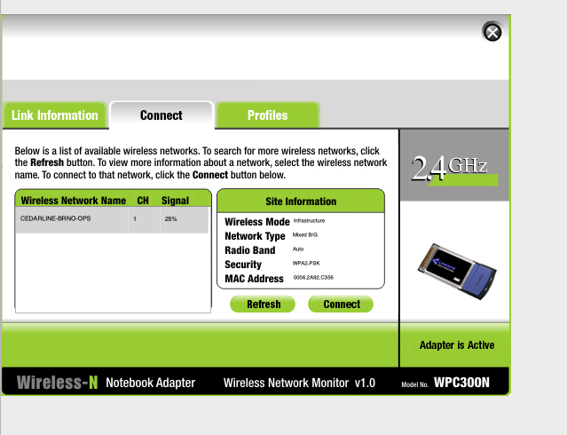

The refreshed Brno scan lists only CEDARLINE-BRNO-OPS. Houston SSIDs are absent from this scan.

## 16. Associate the Brno laptop

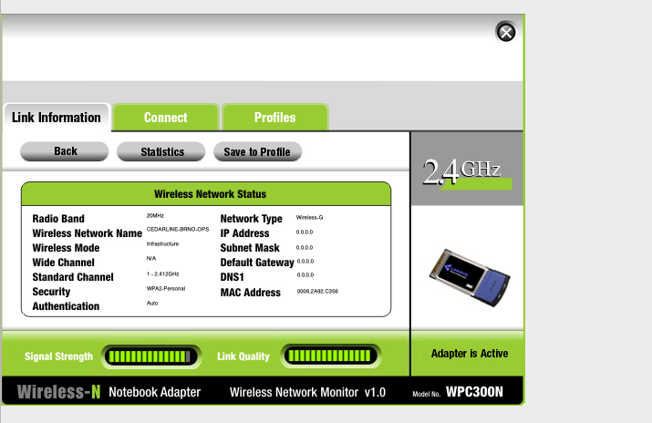

The laptop shows the Brno SSID before obtaining an IPv4 lease.

## 17. Obtain the Brno laptop lease

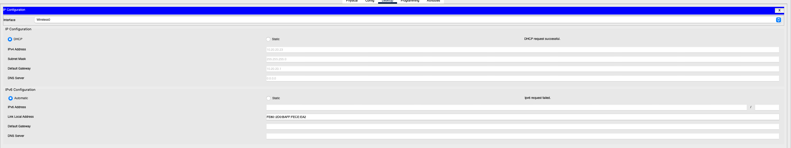

LAP-BRNO-OPS-01 receives 10.20.20.23 and gateway 10.20.20.1 (R-BRNO-01 LAN interface).

## 18. Test the Brno laptop

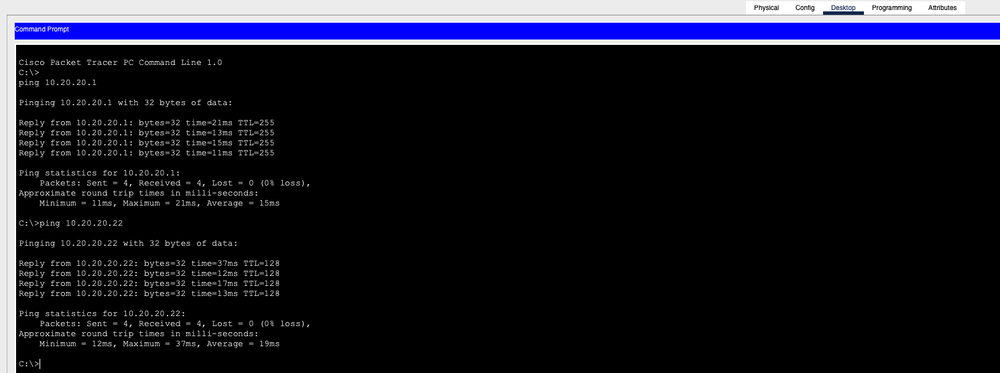

The laptop reaches the Brno gateway and smartphone, with four replies and zero loss for each.

## 19. Retest Houston HTTP after the move

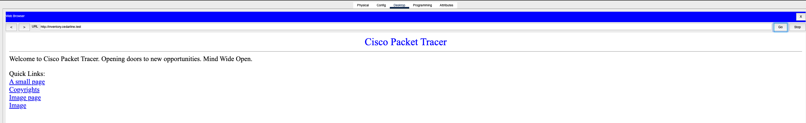

The Houston Finance laptop still loads the inventory page by hostname.

## 20. Retest the Houston guest gateway

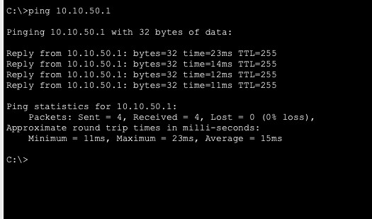

The guest laptop still reaches 10.10.50.1 (Houston guest gateway) with zero loss.

## 21. Label the two-site topology

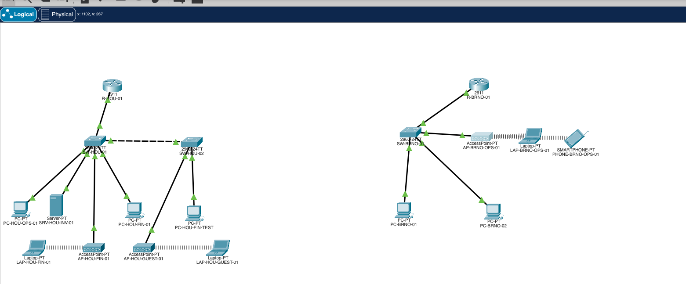

The Brno AP is named AP-BRNO-OPS-01. This view precedes addition of the meeting-room AP.

## 22. Configure meeting-room Finance Wi-Fi

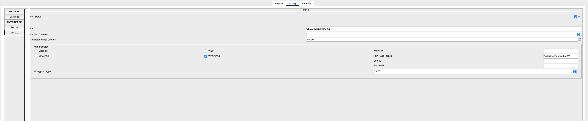

AP-HOU-MEETING-01 uses the Finance SSID and shared lab passphrase, WPA2-PSK/AES, and configured channel 11. Its access port is SW-HOU-01 Fa0/8 in VLAN 10.

## 23. Isolate the meeting-room path

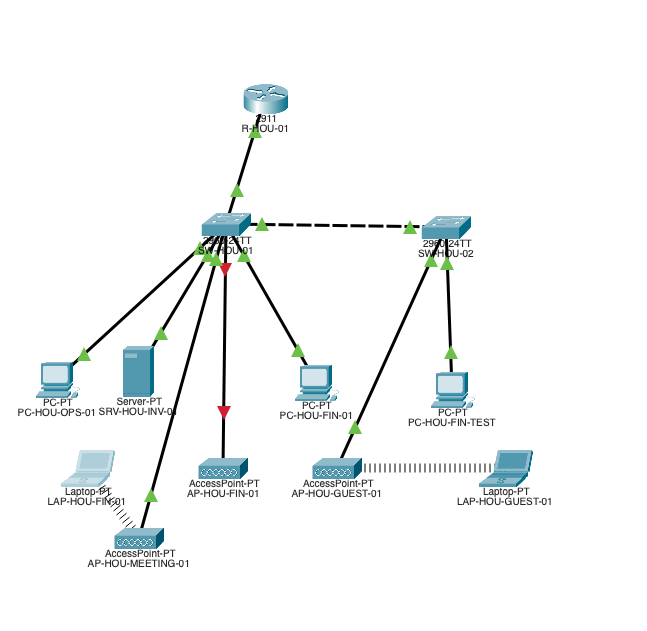

The original Finance AP uplink on Fa0/7 is shut down. The topology shows the laptop associated with the meeting-room AP, whose uplink remains active.

## 24. Record the channel-display discrepancy

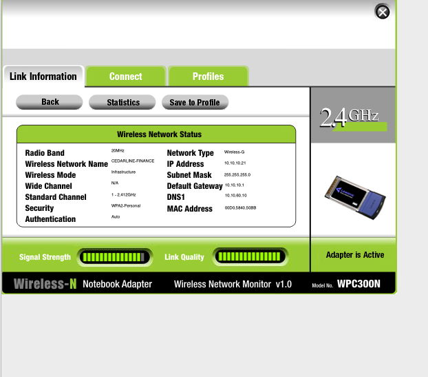

The client still displays channel 1 despite the meeting AP configuration showing 11. This discrepancy remains unresolved. The following tests verify connectivity with the original AP uplink disabled.

## 25. Verify the isolated gateway path

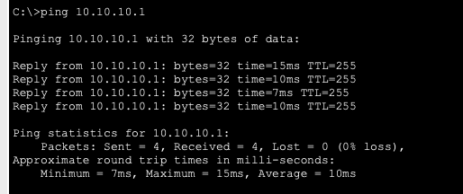

With Fa0/7 disabled, the laptop reaches 10.10.10.1 (Finance gateway) with four replies and zero loss.

## 26. Verify isolated DNS and HTTP access

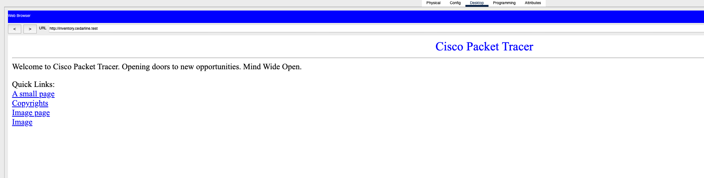

The inventory page loads by hostname while the original Finance AP uplink is disabled.

## 27. Restore the office topology

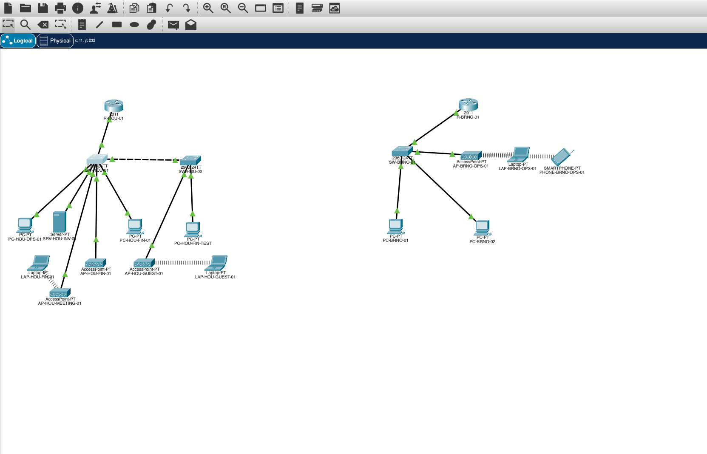

The final topology shows both Finance AP uplinks green after restoration.

## Screenshot index

| Figure | Evidence |
| --- | --- |
| 01 | [Configure Finance Wi-Fi](screenshots/01-finance-ap-security.png) |
| 02 | [Associate the Finance laptop](screenshots/02-finance-wireless-association.png) |
| 03 | [Obtain Finance DHCP settings](screenshots/03-finance-wireless-dhcp.png) |
| 04 | [Test Finance wireless reachability](screenshots/04-finance-wireless-pings.png) |
| 05 | [Retest inventory reachability](screenshots/05-finance-inventory-ping-retest.png) |
| 06 | [Open the inventory page by hostname](screenshots/06-finance-inventory-by-name.png) |
| 07 | [Associate the guest laptop](screenshots/07-guest-wireless-association.png) |
| 08 | [Obtain guest DHCP settings](screenshots/08-guest-wireless-dhcp.png) |
| 09 | [Record the guest baseline](screenshots/09-guest-before-hardening-pings.png) |
| 10 | [Connect the Brno smartphone](screenshots/10-brno-smartphone-wireless-dhcp.png) |
| 11 | [Test wired-to-wireless access](screenshots/11-brno-wired-to-smartphone-ping.png) |
| 12 | [Investigate cross-city SSID visibility](screenshots/12-brno-scan-before-physical-separation.png) |
| 13 | [Create separate physical cities](screenshots/13-houston-brno-physical-cities.png) |
| 14 | [Move Brno equipment](screenshots/14-brno-device-physical-location.png) |
| 15 | [Verify the wireless scan after separation](screenshots/15-brno-scan-after-physical-separation.png) |
| 16 | [Associate the Brno laptop](screenshots/16-brno-laptop-association-before-dhcp.png) |
| 17 | [Obtain the Brno laptop lease](screenshots/17-brno-laptop-dhcp.png) |
| 18 | [Test the Brno laptop](screenshots/18-brno-laptop-gateway-smartphone-pings.png) |
| 19 | [Retest Houston HTTP after the move](screenshots/19-houston-finance-http-after-move.png) |
| 20 | [Retest the Houston guest gateway](screenshots/20-houston-guest-gateway-after-move.png) |
| 21 | [Label the two-site topology](screenshots/21-two-site-wireless-topology.png) |
| 22 | [Configure meeting-room Finance Wi-Fi](screenshots/22-meeting-room-ap-security.png) |
| 23 | [Isolate the meeting-room path](screenshots/23-meeting-ap-isolated-topology.png) |
| 24 | [Record the channel-display discrepancy](screenshots/24-client-channel-display-discrepancy.png) |
| 25 | [Verify the isolated gateway path](screenshots/25-meeting-ap-gateway-ping.png) |
| 26 | [Verify isolated DNS and HTTP access](screenshots/26-meeting-ap-inventory-http.png) |
| 27 | [Restore the office topology](screenshots/27-restored-wireless-topology.png) |

## Completion and remaining work

The captured tests verify wireless association, DHCP, Houston DNS/HTTP access, and Brno local connectivity. Separate physical locations removed cross-city SSID visibility. The meeting-room test succeeded with the original AP uplink disabled.

Guest isolation, external access, and intersite VPN testing remain scheduled for later sprints. Finance is the Houston staff WLAN implemented here. Other departments’ wireless access remains open. Physical placement is simulated and no real RF coverage survey was performed. The guest channel should be checked against the planned channel 6. The meeting-room client channel display discrepancy remains unresolved.

The lab ran locally with synthetic data at $0. Screenshots are actual captures supplied during configuration and testing.
