# Sprint 05 · Network hardening

Guest isolation, camera access restrictions, unused-port shutdown, a tested sticky-MAC workstation port, and restricted SSH administration were implemented in the local Packet Tracer lab. IoT registration was moved off the inventory server to a dedicated Security VLAN server. Open [cedarline-hardening.pkt](cedarline-hardening.pkt).

## Implemented controls

| Control | Placement | Verification |
| --- | --- | --- |
| HOU-GUEST-IN | R-HOU-01 Gi0/0.50 inbound | Guest gateway and DNS permitted; internal server/camera pings and inventory HTTP blocked |
| HOU-CAMERAS-OUT | R-HOU-01 Gi0/0.80 outbound | Security PC and dedicated IoT server allowed to camera; Operations denied |
| HOU-IOT-SERVER-OUT | R-HOU-01 Gi0/0.40 outbound | Camera registration permitted; Operations portal access blocked; Security local access retained |
| HOU-MGMT-SOURCES | R-HOU-01 VTY 0–4 inbound access-class | Security SSH succeeds; Operations SSH refused |
| SSH-only VTY login | R-HOU-01 | SSH v2, local privileged netadmin account, 60-second authentication timeout, user-selected 3 retries, 5-minute idle timeout |
| Sticky MAC | SW-HOU-01 Fa0/10, VLAN 40 | Authorized MAC 0060.5C13.5859 works; replacement causes secure-shutdown; authorized PC restored |
| Parking VLAN 999 | All four switches | Unused interfaces administratively disabled; active uplinks retained |

## Final device and port changes

SRV-HOU-IOT-01 uses 10.10.40.10 (dedicated IoT registration server) and gateway 10.10.40.1 (Security gateway), connected to SW-HOU-01 Fa0/11 in VLAN 40. That port was reactivated from the parking VLAN after the initial unused-port exercise. PC-HOU-SEC-01 remains at 10.10.40.11 (Security workstation) on Fa0/10. CAM-HOU-ENTRANCE-01 remains at 10.10.80.11 (entrance camera).

The original 10.10.60.10 (inventory/DNS server) retains DNS and HTTP; its IoT service was turned off as instructed, and the regular HTTP page was subsequently observed. Its former camera ACL permission was removed and the final ACL captured.

| Switch | Final unused ports in VLAN 999, shutdown | Count |
| --- | --- | --- |
| SW-HOU-01 | Fa0/3–4, Fa0/6, Fa0/12–24 | 16 |
| SW-HOU-02 | Fa0/1, Fa0/3–5, Fa0/7–24 | 22 |
| SW-HOU-POE-01 | Fa0/4–23, Gi0/2 | 21 |
| SW-BRNO-01 | Fa0/4–24, Gi0/2 | 22 |

The initial exercise disabled 82 ports. The dedicated IoT server later reused Fa0/11, leaving 81 planned disabled ports in the final topology. A final all-switch port-status capture after this reuse was not supplied.

## Access policy details

HOU-GUEST-IN permits DHCP client requests, UDP/TCP DNS to 10.10.60.10 (DNS server), and ICMP echo to 10.10.50.1 (Guest gateway). It then denies destinations in the three RFC1918 private ranges and permits remaining traffic. No external Internet service or public destination was implemented or tested.

HOU-CAMERAS-OUT permits 10.10.40.10 (IoT server) and 10.10.40.11 (Security workstation) to 10.10.80.11 (camera), denies other traffic destined to the Cameras subnet, then permits other destinations. The old inventory server exception was removed after migration.

HOU-IOT-SERVER-OUT permits 10.10.80.11 (camera) to 10.10.40.10 (IoT server), denies other routed traffic to that server, then permits other destinations. Security workstation traffic reaches the server locally in VLAN 40 and does not traverse this router ACL.

## Troubleshooting and recovery

- Guest DHCP initially supplied no DNS server. HOU-GUEST was updated with 10.10.60.10 (DNS server), the lease renewed, and successful resolution captured. A mistyped hostname also produced an NXDOMAIN response before the correct lookup succeeded.
- SW-HOU-02 Fa0/7–24 initially remained notconnect after being parked. A follow-up shutdown made them disabled; both intermediate and corrected evidence are preserved.
- Port security learned the authorized workstation MAC. A temporary PC using 10.10.40.99 (replacement-device test address) caused one violation and secure-shutdown. Reconnecting the authorized PC and issuing shutdown/no shutdown restored secure-up and connectivity. The simulator reset the violation count to zero during recovery. The temporary device was instructed to remain disconnected and is absent from the final topology capture.
- Telnet briefly reported Open and then closed without a login prompt. The captured VTY configuration confirms transport input ssh; the transient message alone was not treated as proof.
- The first migration ACL capture still contained the inventory server permit. A second removal was verified by the final rule listing.
- Finance initially lacked usable DNS settings during the final HTTP check. After lease renewal it resolved the inventory hostname and loaded the default HTTP page.

## Regression tests

Brno laptop gateway and smartphone pings passed with zero loss after unused-port shutdown. Finance DNS and HTTP access passed after service separation. Reception extension 7001 called Operations extension 7002 successfully after hardening. Operations retained printer reachability with a zero-loss repeat ping. Security retained camera control through the new portal after its access restriction.

## Limits and remaining work

These are stateless router ACLs, not a stateful firewall. Source IP and MAC restrictions do not establish user identity and can be spoofed. Sticky MAC protection was implemented and tested only on the Security workstation port. SSH hardening was implemented and tested only on R-HOU-01; the other devices' remote management remains outside this verified scope. Devices within VLAN 40 can reach the IoT server locally, and same-VLAN camera traffic would bypass the routed ACL. No separate management VLAN was deployed. Camera egress is not comprehensively restricted by these destination ACLs.

The inventory endpoint is the simulator's default HTTP page, not a production inventory application. Camera imagery is simulated. Lab credentials in screenshots are public synthetic values. No real video retention, actual printer job, external connectivity, VPN, restart persistence or dedicated stateful firewall was verified. The project remains local and costs $0. Intersite connectivity and VPN work remain for Sprint 6; final troubleshooting/handoff remains for Sprint 7.

## Evidence walkthrough

All images are actual user-supplied screenshots. Intermediate failures are retained and must not be interpreted as final successful configurations.

### 01. Guest before hardening internal access

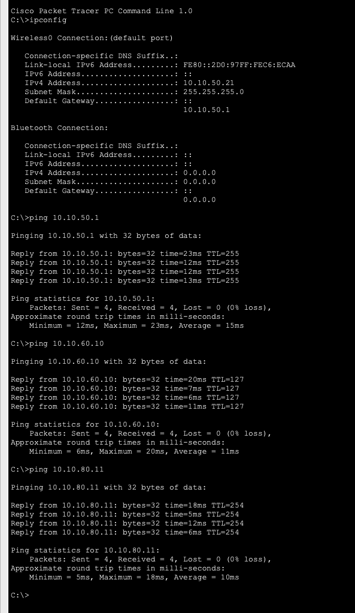

Configuration or validation evidence captured during this sprint.

### 02. Guest gateway allowed server camera blocked

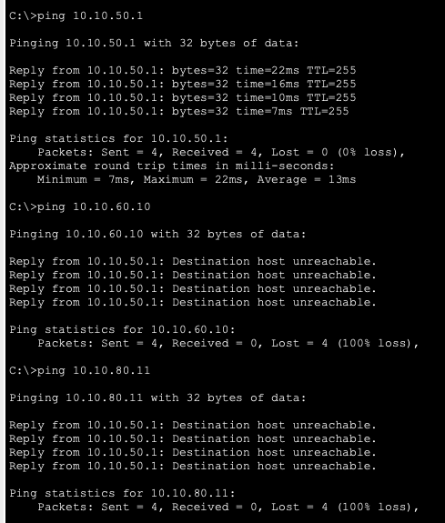

Configuration or validation evidence captured during this sprint.

### 03. Guest dhcp lease missing dns server

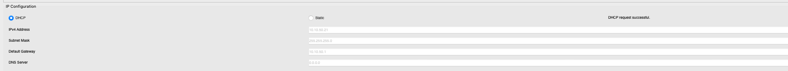

Configuration or validation evidence captured during this sprint.

### 04. Guest dns resolution allowed after dhcp fix

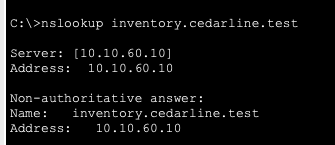

Configuration or validation evidence captured during this sprint.

### 05. Guest inventory http blocked

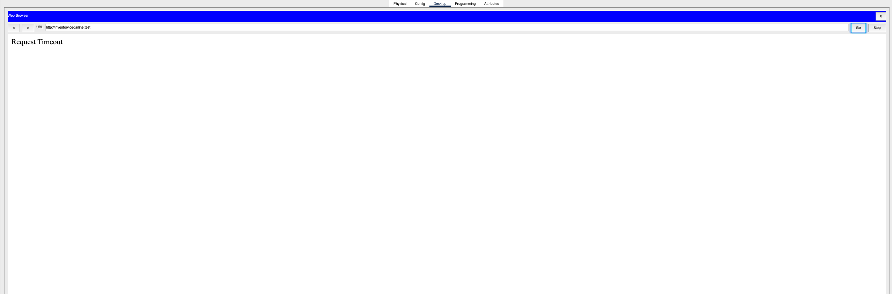

Configuration or validation evidence captured during this sprint.

### 06. Finance http reachable iot login

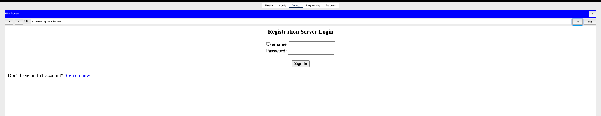

Configuration or validation evidence captured during this sprint.

### 07. Guest acl permit and deny counters

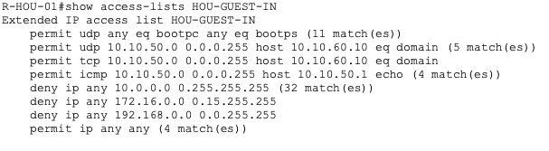

Configuration or validation evidence captured during this sprint.

### 08. Operations camera ping blocked

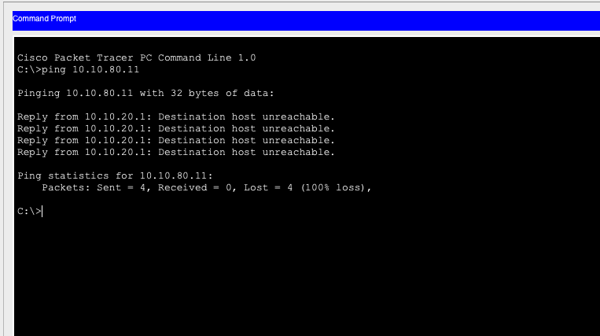

Configuration or validation evidence captured during this sprint.

### 09. Camera portal green after camera acl

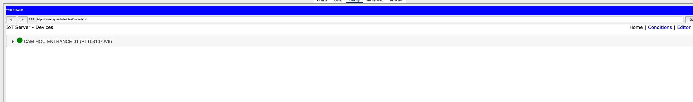

Configuration or validation evidence captured during this sprint.

### 10. Security camera ping allowed

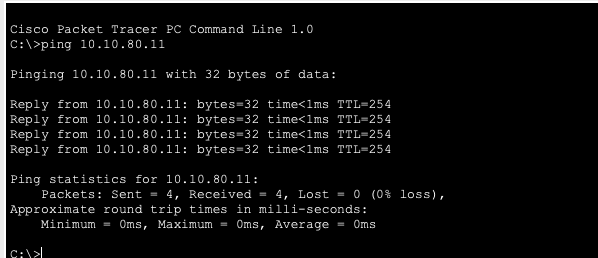

Configuration or validation evidence captured during this sprint.

### 11. Camera acl security server permits and denies

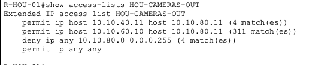

Configuration or validation evidence captured during this sprint.

### 12. Main switch port status and vlans before hardening

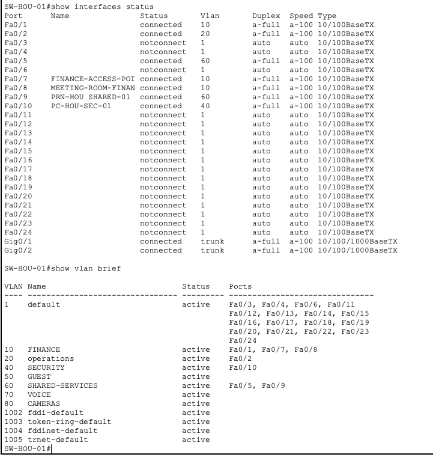

Configuration or validation evidence captured during this sprint.

### 13. Main switch unused ports disabled vlan999

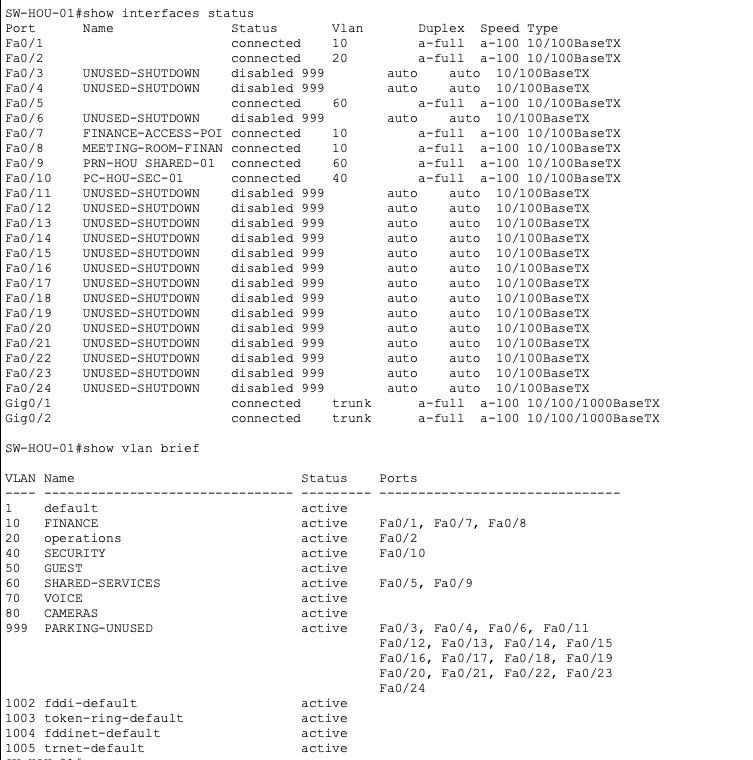

Configuration or validation evidence captured during this sprint.

### 14. Second switch unused port baseline

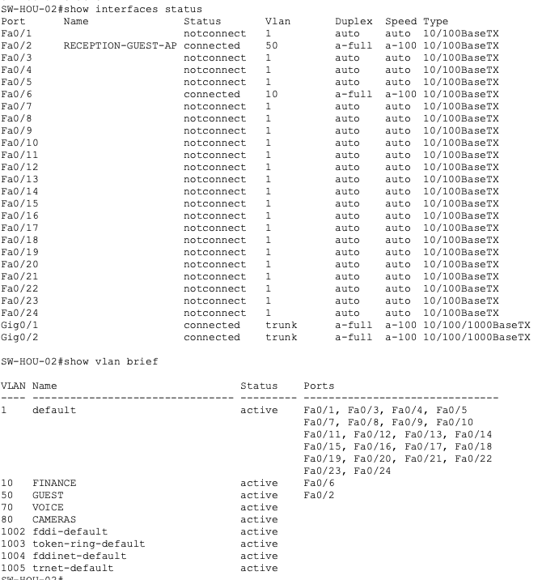

Configuration or validation evidence captured during this sprint.

### 15. Second switch parking vlan partial shutdown

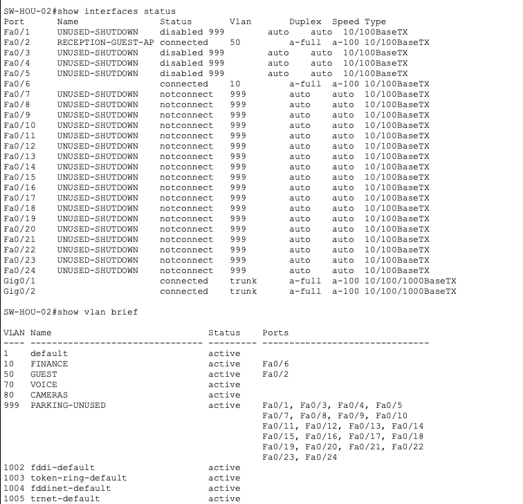

Intermediate state: ports Fa0/7–24 were parked but still administratively enabled.

### 16. Second switch unused ports disabled vlan999

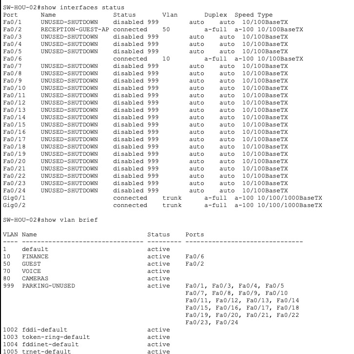

Follow-up output confirms the remaining unused ports are disabled.

### 17. Poe switch unused port baseline

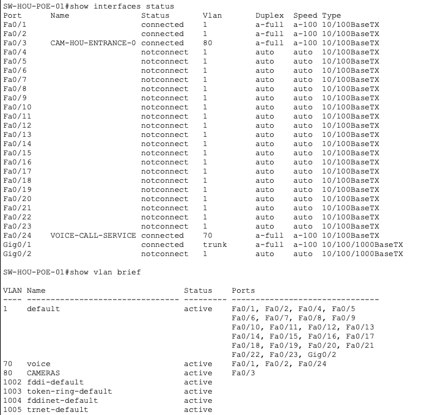

Configuration or validation evidence captured during this sprint.

### 18. Poe switch unused ports disabled vlan999

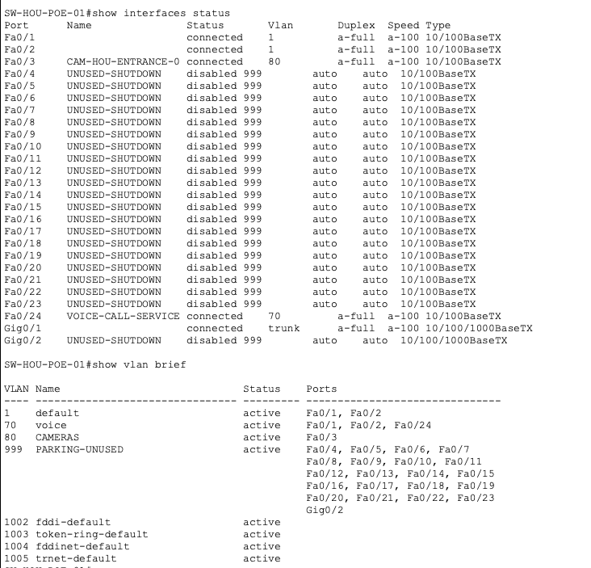

Configuration or validation evidence captured during this sprint.

### 19. Brno switch unused port baseline

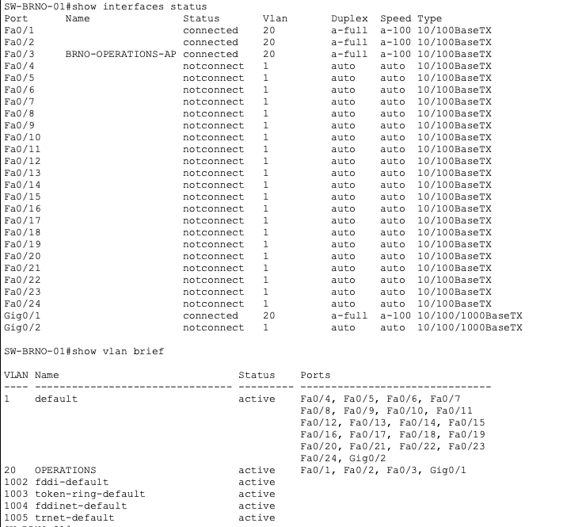

Configuration or validation evidence captured during this sprint.

### 20. Brno switch unused ports disabled vlan999

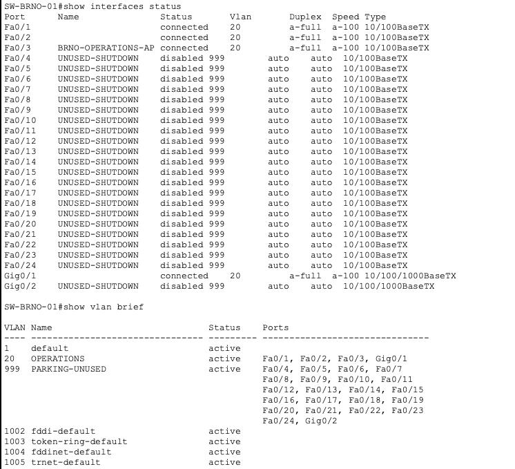

Configuration or validation evidence captured during this sprint.

### 21. Brno connectivity after unused port shutdown

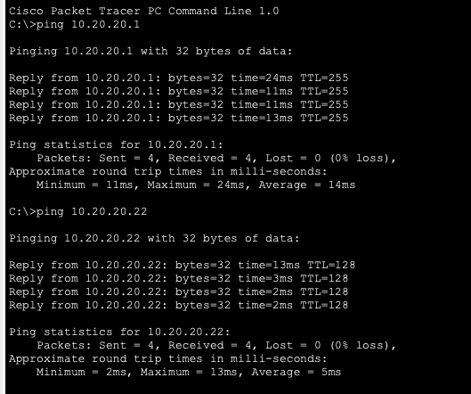

Configuration or validation evidence captured during this sprint.

### 22. Security workstation port security disabled baseline

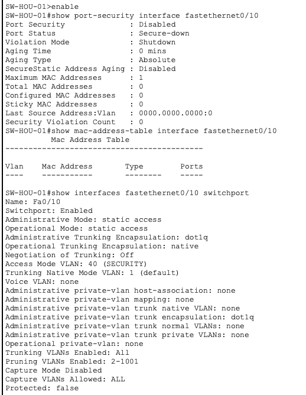

Configuration or validation evidence captured during this sprint.

### 23. Security port sticky mac secure up zero violations

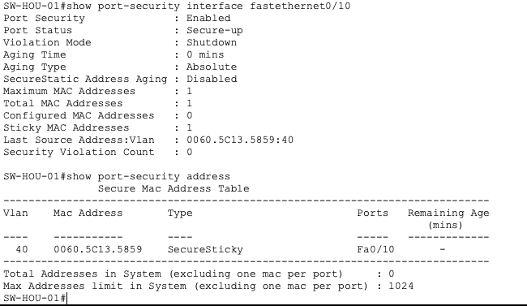

Configuration or validation evidence captured during this sprint.

### 24. Authorized security pc gateway ping success

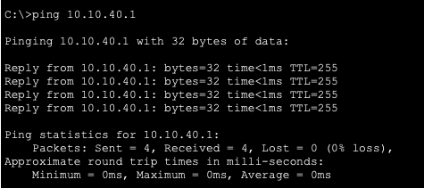

Configuration or validation evidence captured during this sprint.

### 25. Unauthorized replacement pc gateway ping blocked

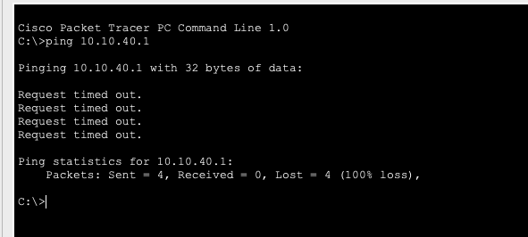

Configuration or validation evidence captured during this sprint.

### 26. Security port shutdown after mac violation

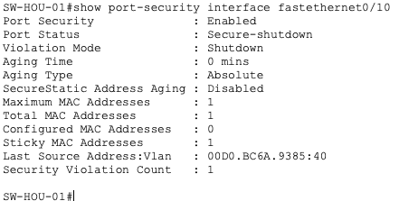

The replacement MAC triggers secure-shutdown and one recorded violation.

### 27. Authorized security pc ping restored after recovery

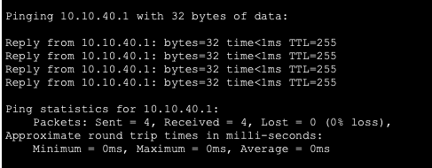

Configuration or validation evidence captured during this sprint.

### 28. Security port recovered original sticky mac

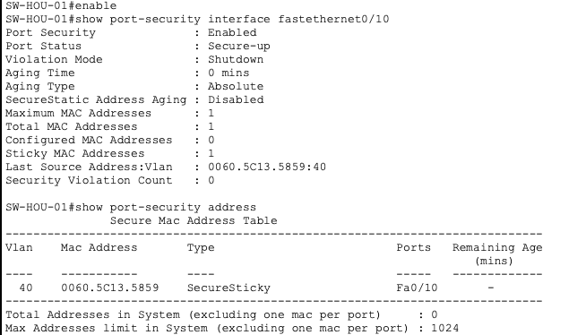

Recovery restores the original sticky MAC and secure-up; violation count displays zero.

### 29. Router ssh disabled baseline

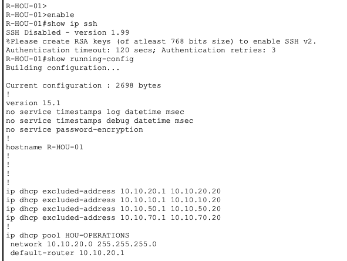

Configuration or validation evidence captured during this sprint.

### 30. Router vty login baseline

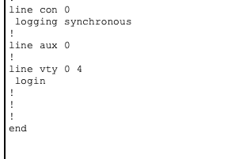

Configuration or validation evidence captured during this sprint.

### 31. Security workstation ssh login success

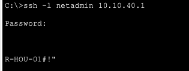

Configuration or validation evidence captured during this sprint.

### 32. Operations workstation ssh connection refused

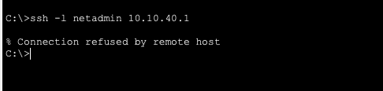

Configuration or validation evidence captured during this sprint.

### 33. Ssh v2 three retries management acl counters

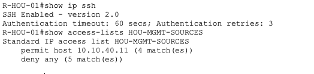

SSH v2 is enabled. Three retries reflect the user’s deliberate choice.

### 34. Security telnet opens then remote closes

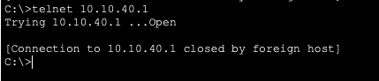

Telnet reports Open and then closes without a usable login session.

### 35. Router vty ssh only source restricted local login

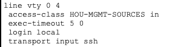

VTY configuration explicitly allows SSH only and applies the management source ACL.

### 36. Security to dedicated iot server ping

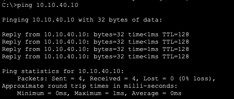

Configuration or validation evidence captured during this sprint.

### 37. Dedicated iot portal login before camera migration

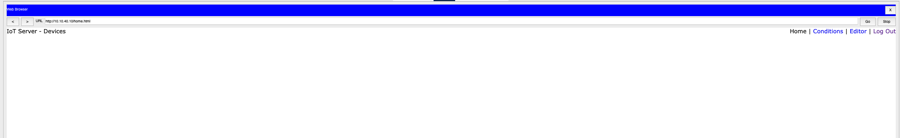

Configuration or validation evidence captured during this sprint.

### 38. Camera registered on dedicated iot server

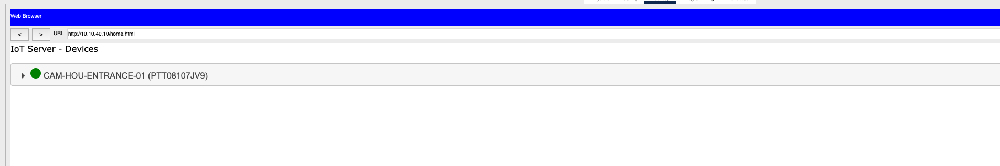

Configuration or validation evidence captured during this sprint.

### 39. Dedicated iot server camera control success

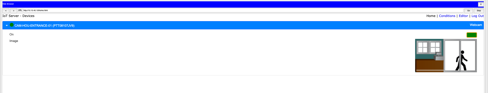

Configuration or validation evidence captured during this sprint.

### 40. Camera acl new iot server permit matches

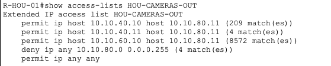

Intermediate migration state still includes the old inventory server camera permission.

### 41. Operations dedicated iot portal blocked

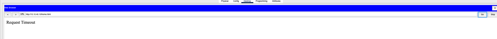

Configuration or validation evidence captured during this sprint.

### 42. Security dedicated iot login page allowed

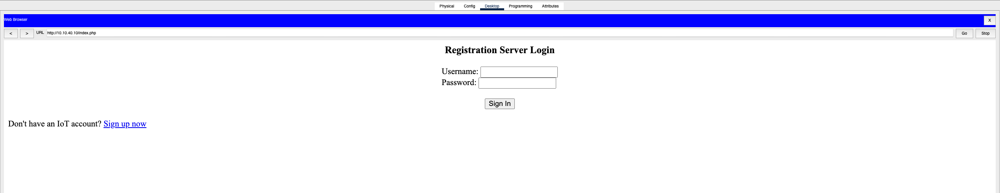

Configuration or validation evidence captured during this sprint.

### 43. Security camera control after portal restriction

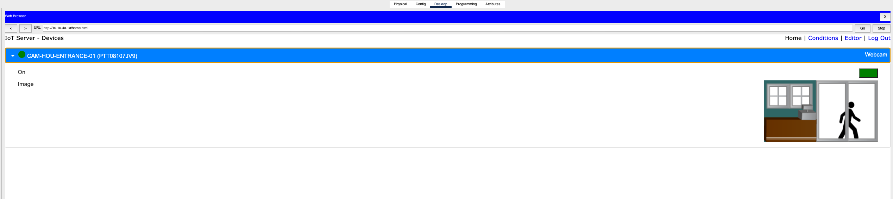

Configuration or validation evidence captured during this sprint.

### 44. Iot acl counters old server camera permit still present

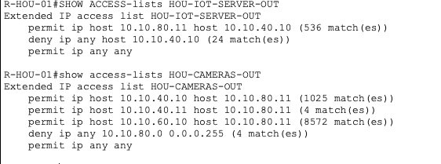

Portal restriction works, but old camera permission remains pending removal.

### 45. Final camera acl old server permission removed

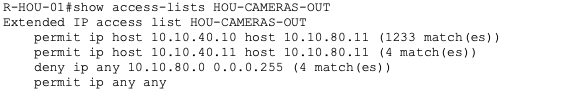

Final camera ACL removes the old inventory server permission.

### 46. Finance dns restored after lease renewal

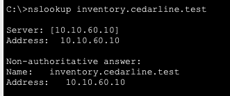

Configuration or validation evidence captured during this sprint.

### 47. Finance inventory http restored after iot separation

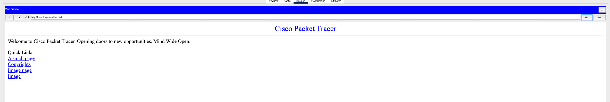

Finance loads the default HTTP page by hostname after IoT service separation.

### 48. Phone call connected after hardening

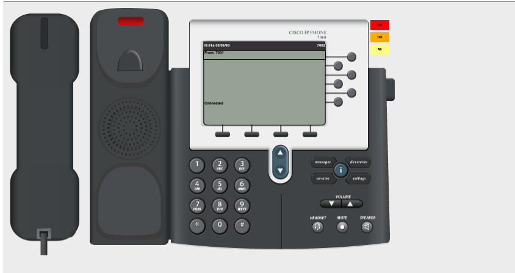

Configuration or validation evidence captured during this sprint.

### 49. Operations printer ping after hardening

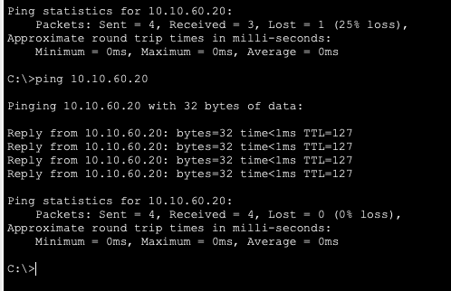

Configuration or validation evidence captured during this sprint.

### 50. Final hardening topology

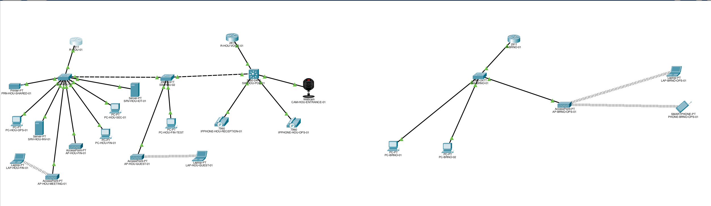

Final topology includes the dedicated IoT server; Houston and Brno still have no WAN link.

## Screenshot index

| Figure | Evidence |
| --- | --- |
| 01 | [Guest before hardening internal access](screenshots/01-guest-before-hardening-internal-access.png) |
| 02 | [Guest gateway allowed server camera blocked](screenshots/02-guest-gateway-allowed-server-camera-blocked.png) |
| 03 | [Guest dhcp lease missing dns server](screenshots/03-guest-dhcp-lease-missing-dns-server.png) |
| 04 | [Guest dns resolution allowed after dhcp fix](screenshots/04-guest-dns-resolution-allowed-after-dhcp-fix.png) |
| 05 | [Guest inventory http blocked](screenshots/05-guest-inventory-http-blocked.png) |
| 06 | [Finance http reachable iot login](screenshots/06-finance-http-reachable-iot-login.png) |
| 07 | [Guest acl permit and deny counters](screenshots/07-guest-acl-permit-and-deny-counters.png) |
| 08 | [Operations camera ping blocked](screenshots/08-operations-camera-ping-blocked.png) |
| 09 | [Camera portal green after camera acl](screenshots/09-camera-portal-green-after-camera-acl.png) |
| 10 | [Security camera ping allowed](screenshots/10-security-camera-ping-allowed.png) |
| 11 | [Camera acl security server permits and denies](screenshots/11-camera-acl-security-server-permits-and-denies.png) |
| 12 | [Main switch port status and vlans before hardening](screenshots/12-main-switch-port-status-and-vlans-before-hardening.png) |
| 13 | [Main switch unused ports disabled vlan999](screenshots/13-main-switch-unused-ports-disabled-vlan999.png) |
| 14 | [Second switch unused port baseline](screenshots/14-second-switch-unused-port-baseline.png) |
| 15 | [Second switch parking vlan partial shutdown](screenshots/15-second-switch-parking-vlan-partial-shutdown.png) |
| 16 | [Second switch unused ports disabled vlan999](screenshots/16-second-switch-unused-ports-disabled-vlan999.png) |
| 17 | [Poe switch unused port baseline](screenshots/17-poe-switch-unused-port-baseline.png) |
| 18 | [Poe switch unused ports disabled vlan999](screenshots/18-poe-switch-unused-ports-disabled-vlan999.png) |
| 19 | [Brno switch unused port baseline](screenshots/19-brno-switch-unused-port-baseline.png) |
| 20 | [Brno switch unused ports disabled vlan999](screenshots/20-brno-switch-unused-ports-disabled-vlan999.png) |
| 21 | [Brno connectivity after unused port shutdown](screenshots/21-brno-connectivity-after-unused-port-shutdown.png) |
| 22 | [Security workstation port security disabled baseline](screenshots/22-security-workstation-port-security-disabled-baseline.png) |
| 23 | [Security port sticky mac secure up zero violations](screenshots/23-security-port-sticky-mac-secure-up-zero-violations.png) |
| 24 | [Authorized security pc gateway ping success](screenshots/24-authorized-security-pc-gateway-ping-success.png) |
| 25 | [Unauthorized replacement pc gateway ping blocked](screenshots/25-unauthorized-replacement-pc-gateway-ping-blocked.png) |
| 26 | [Security port shutdown after mac violation](screenshots/26-security-port-shutdown-after-mac-violation.png) |
| 27 | [Authorized security pc ping restored after recovery](screenshots/27-authorized-security-pc-ping-restored-after-recovery.png) |
| 28 | [Security port recovered original sticky mac](screenshots/28-security-port-recovered-original-sticky-mac.png) |
| 29 | [Router ssh disabled baseline](screenshots/29-router-ssh-disabled-baseline.png) |
| 30 | [Router vty login baseline](screenshots/30-router-vty-login-baseline.png) |
| 31 | [Security workstation ssh login success](screenshots/31-security-workstation-ssh-login-success.png) |
| 32 | [Operations workstation ssh connection refused](screenshots/32-operations-workstation-ssh-connection-refused.png) |
| 33 | [Ssh v2 three retries management acl counters](screenshots/33-ssh-v2-three-retries-management-acl-counters.png) |
| 34 | [Security telnet opens then remote closes](screenshots/34-security-telnet-opens-then-remote-closes.png) |
| 35 | [Router vty ssh only source restricted local login](screenshots/35-router-vty-ssh-only-source-restricted-local-login.png) |
| 36 | [Security to dedicated iot server ping](screenshots/36-security-to-dedicated-iot-server-ping.png) |
| 37 | [Dedicated iot portal login before camera migration](screenshots/37-dedicated-iot-portal-login-before-camera-migration.png) |
| 38 | [Camera registered on dedicated iot server](screenshots/38-camera-registered-on-dedicated-iot-server.png) |
| 39 | [Dedicated iot server camera control success](screenshots/39-dedicated-iot-server-camera-control-success.png) |
| 40 | [Camera acl new iot server permit matches](screenshots/40-camera-acl-new-iot-server-permit-matches.png) |
| 41 | [Operations dedicated iot portal blocked](screenshots/41-operations-dedicated-iot-portal-blocked.png) |
| 42 | [Security dedicated iot login page allowed](screenshots/42-security-dedicated-iot-login-page-allowed.png) |
| 43 | [Security camera control after portal restriction](screenshots/43-security-camera-control-after-portal-restriction.png) |
| 44 | [Iot acl counters old server camera permit still present](screenshots/44-iot-acl-counters-old-server-camera-permit-still-present.png) |
| 45 | [Final camera acl old server permission removed](screenshots/45-final-camera-acl-old-server-permission-removed.png) |
| 46 | [Finance dns restored after lease renewal](screenshots/46-finance-dns-restored-after-lease-renewal.png) |
| 47 | [Finance inventory http restored after iot separation](screenshots/47-finance-inventory-http-restored-after-iot-separation.png) |
| 48 | [Phone call connected after hardening](screenshots/48-phone-call-connected-after-hardening.png) |
| 49 | [Operations printer ping after hardening](screenshots/49-operations-printer-ping-after-hardening.png) |
| 50 | [Final hardening topology](screenshots/50-final-hardening-topology.png) |
